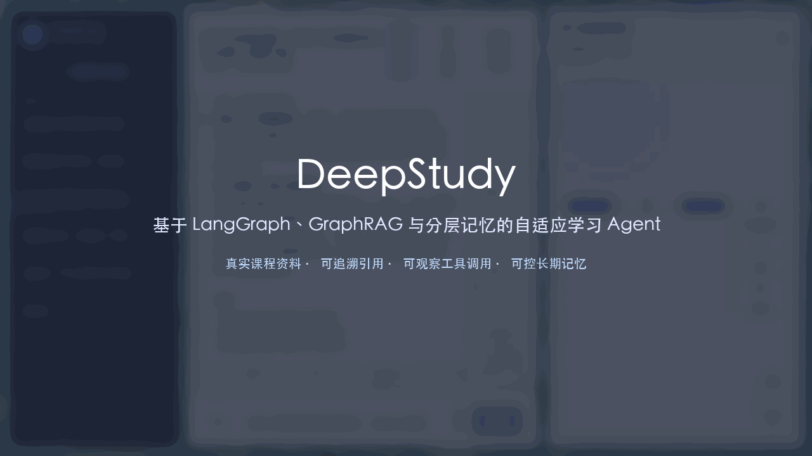
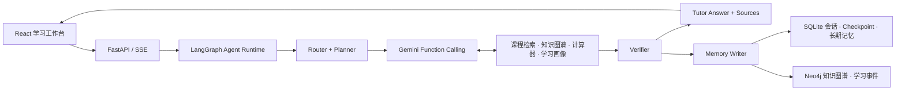
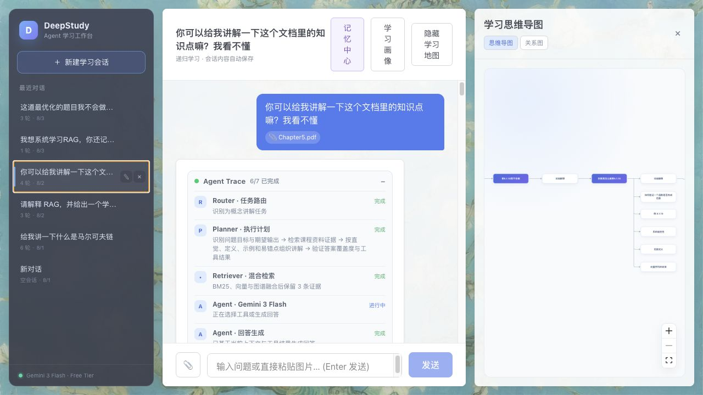

# DeepStudy

基于 LangGraph 与 Gemini 3 Flash 的递归学习 Agent：支持 Function Calling、Agent Trace、GraphRAG、分层 Memory、Skills 与 MCP。

核心 Agent、RAG、Memory 与作品集包装四个阶段均已完成。实现边界与仍未完成项见
[实现状态](backend/IMPLEMENTATION_STATUS.md)，完整演进见
[优化路线图](docs/OPTIMIZATION_ROADMAP.md)。



## 技术栈

- **前端**: React + TypeScript + ReactFlow + Vite
- **后端**: FastAPI + LangGraph + Python
- **模型**: Gemini 3 Flash（Gemini Developer API 免费层）
- **数据库**: Neo4j（对话与知识图谱）+ SQLite（用户数据与学习画像）
- **认证**: 当前单用户场景（anonymous），JWT 预留

## 系统架构



## 功能矩阵

| 能力 | 实现 | 用户可见证据 | 降级策略 |
| --- | --- | --- | --- |
| Agent 编排 | LangGraph Router–Planner–Executor–Verifier | SSE Agent Trace 与历史回放 | 路由、验证使用本地确定性逻辑 |
| Tool Calling | Gemini 原生 Function Calling + Pydantic Schema | 工具名、参数摘要、耗时与结果 | 单轮工具循环，避免免费额度失控 |
| RAG | PDF/Markdown/TXT/代码结构化切片 | 页码、章节、可点击原文 | BGE 不可用时使用确定性 n-gram embedding |
| GraphRAG | BM25 + 向量 + Neo4j，经加权 RRF 与覆盖率重排 | 学习思维导图 / 知识关系图 | Neo4j 不可用时保留关键词与向量检索 |
| 分层 Memory | 会话、Checkpoint、语义/情景记忆、U/R/A 画像 | 记忆中心可确认、编辑、永久遗忘 | 仅写入通过验证且达到阈值的记忆 |
| 多模态 | 图片直达 Gemini；文档进入索引任务 | 粘贴/上传、解析进度、失败原因 | 格式、大小与解析错误分层提示 |
| Skills / MCP | 4 个渐进加载 Skills；3 Tools、2 Resources、2 Prompts | Trace 显示命中 Skill，外部 Host 可复用 | 独立于主 Agent 运行时，可单独停用 |

## 项目结构

```
DeepStudy/
├── frontend/              # React 前端
│   ├── src/
│   │   ├── components/    # Chat、MindMap、Markdown
│   │   ├── services/      # API 封装
│   │   └── types/         # 类型定义
│   └── README.md
├── backend/               # FastAPI 后端
│   ├── api/               # 路由与 schemas
│   ├── agent/             # LangGraph、Provider、工具、状态与提取器
│   ├── data/              # Neo4j、SQLite、画像与归一化
│   └── README.md
└── README.md
```

## 功能概览

- **流式对话**：首轮提问与划词追问均支持流式输出。
- **Agent 主链路**：Router → Planner → Gemini Function Calling → Tool Executor → Verifier → Memory Writer。
- **Agent Trace**：通过标准 SSE 实时展示节点、工具参数摘要与验证结果，并随历史消息持久化。
- **RAG / GraphRAG**：课程资料经过结构化切片、BM25 + 向量 + 图谱融合检索与重排，回答展示页码、章节和可点击来源。
- **多模态附件**：支持直接粘贴图片，也支持上传图片、PDF、Markdown、TXT 与常见代码文件；图片直接交给 Gemini 理解，文档显示解析/索引进度。
- **知识图谱**：对话树与概念节点写入 Neo4j，侧边栏用 ReactFlow 展示；学习计划内的概念在图谱上以淡绿色卡片高亮。
- **学习画像**：按概念维护 U/R/A 与练习次数；支持查看和删除；Memory Writer 用本地概念提取更新画像，避免额外消耗免费模型请求。
- **分层 Memory**：会话短期记忆、LangGraph Checkpoint、跨会话语义/情景记忆与 U/R/A 画像；长期记忆支持去重、相关检索、确认、编辑和永久遗忘。
- **Agent Skills**：概念讲解、公式推导、生成练习与错题复盘，按元数据选择后渐进加载完整指令。
- **MCP Server**：向外部 Agent Host 暴露课程检索、概念图谱、练习生成、课程/概念资源和教学 Prompts。
- **学习计划**：用户手动维护的“待重点学习”概念列表，存于后端（多设备/刷新同步）；在学习画像弹层中左侧为概念列表、右侧为学习计划，支持从左侧拖拽或点击「加入计划」，右侧可「移出计划」。
- **概念归一化**：词法规范化 + 别名字典（`profile_aliases.json`）+ 可选 Embedding 合并；LLM 可建议别名并动态追加到别名表。

## 快速开始

### 环境要求

- **Node.js** >= 18
- **Python** >= 3.10
- **Docker**（用于 Neo4j）
- **Conda** 或 **venv**

### 1. 克隆与依赖

```bash
git clone <repository-url>
cd DeepStudy
```

### 2. 后端

```bash
# Python 环境
conda create -n deepstudy python=3.10 && conda activate deepstudy
# 或: python -m venv venv && source venv/bin/activate  # Linux/Mac

# 依赖
pip install -r backend/requirements.txt
```

复制安全配置模板：

```bash
cp .env.example backend/.env
```

然后在 `backend/.env` 中设置：

```env
GEMINI_API_KEY=your_gemini_api_key_here
LLM_MODEL=gemini-3-flash-preview
LLM_CODER_MODEL=gemini-3-flash-preview
GEMINI_THINKING_LEVEL=medium
```

完整环境变量以 [.env.example](.env.example) 为准。

### Docker Compose 一键启动

```bash
cp .env.example .env
# 编辑 .env 并填写 GEMINI_API_KEY
docker compose up --build
```

应用：http://localhost:7860

Neo4j Browser：http://localhost:7474

### 3. Neo4j

```bash
docker run -d --name deepstudy-neo4j -p 7474:7474 -p 7687:7687 \
  -e NEO4J_AUTH=neo4j/deepstudy-dev-only neo4j:5.26-community
```

### 4. 启动后端

```bash
# 项目根目录
uvicorn backend.main:app --reload --host 0.0.0.0 --port 8000
```

API 文档：http://localhost:8000/docs

### 5. 前端

```bash
cd frontend
npm install
npm run dev
```

前端：http://localhost:5173

## 使用流程

1. **对话**：在聊天框输入问题，前端会展示 Router、Planner、工具调用、Verifier 和 Memory Writer 的执行摘要。
2. **划词追问**：选中回答中的文本，在弹层中输入追问；选中文本、父回答和会话历史会进入 AgentState。
3. **知识图谱**：右侧可展开/收起侧栏，在思维导图与关系图布局间切换；学习计划中的概念会高亮。
4. **学习画像与学习计划**：顶部「学习画像」打开弹层。左侧为正在学习的概念列表（U/R/A、练习次数、得分），可「删除」从画像移除或「加入计划」；右侧为学习计划，可将左侧概念拖入或点击加入，计划内可「移出计划」。学习计划存于后端，多设备与刷新后仍保留。
5. **记忆中心**：顶部「记忆中心」查看跨会话语义记忆和学习情景；可手动添加、确认、编辑或永久遗忘。

### MCP Server

```bash
python -m backend.mcp_server
```

以 stdio 方式连接，服务入口为 `backend.mcp_server`；MCP Host 的工作目录应设为项目根目录。

## 开发指南

- [前端开发指南](frontend/README.md)
- [后端开发指南](backend/README.md)
- [优化路线图](docs/OPTIMIZATION_ROADMAP.md)

## 质量检查

```bash
make test
make build
make compose-config

# 30 条检索回归集（输出 Recall@5、MRR、nDCG@5）
python -m backend.evals.run_rag_eval

# 旧版向量单路 vs 当前混合检索的可复现对比
python -m backend.evals.run_rag_eval --compare

# 重新生成恰好 90 秒的演示 GIF
make portfolio
```

30 条仓库内课程查询的确定性离线回归结果：

| 检索方案 | Recall@5 | MRR | nDCG@5 |
| --- | ---: | ---: | ---: |
| 旧版向量单路 | 1.0000 | 0.9444 | 0.9587 |
| 加权 BM25 + 向量 RRF + 覆盖率重排 | 1.0000 | 0.9667 | 0.9754 |
| 变化 | +0.0000 | +0.0223 | +0.0167 |

这是固定 fixture 上的代码回归基线，不代表真实用户资料上的泛化质量。演示流程、
截图、三分钟讲稿和简历表述见 [作品集说明](docs/PORTFOLIO.md)。

## Agent Trace



Trace 只展示计划、工具、证据和验证结果等安全摘要，不展示模型私有推理过程。

## 开发规范

- 分支：`main` 稳定，功能用 `feature/*`
- 遵循单一职责与 SOLID；修改遵循 KISS
- LangGraph 主链路系统指令在 `backend/agent/graph.py`；旧策略 Prompt 保留在 `backend/agent/prompts/` 供兼容参考

## 常见问题

- **Neo4j 连不上**：确认容器运行、端口与 `.env` 中密码一致。
- **Gemini 401/403**：检查 `GEMINI_API_KEY` 是否来自 Google AI Studio。
- **Gemini 429**：免费层额度已用完，请等待额度窗口重置并在 AI Studio 查看限制。
- **前端连不上后端**：确认后端已启动、CORS 包含前端地址；前端 API 基址见 `frontend` README。
