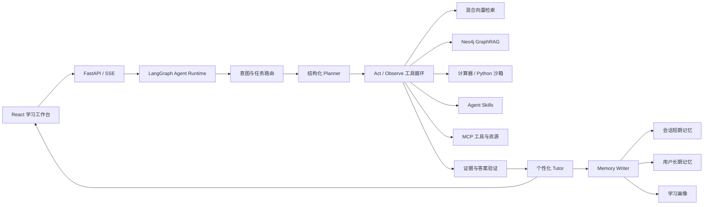

# DeepStudy 优化路线图


## 1. 项目重新定位

DeepStudy 不再定位为普通问答机器人，而是：

**一个基于 Agent、GraphRAG 和分层记忆的自适应学习系统。**

核心用户闭环：

1. 用户上传课程资料。
2. Agent 判断学习任务并制定结构化计划。
3. Agent 调用向量检索、知识图谱、计算器或代码沙箱等工具。
4. 系统依据可追溯证据生成个性化讲解。
5. 系统通过练习或追问验证学习效果。
6. 学习事件写入画像和长期记忆。
7. 后续教学策略依据用户记忆和掌握度自动调整。

## 2. 当前基础与主要差距

### 已有优势

- React + TypeScript + FastAPI 的前后端结构。
- 支持流式回答和划词递归追问。
- 使用 Neo4j 保存并展示对话/概念关系。
- 使用 SQLite 维护 U/R/A 学习画像和学习计划。
- 已有 LlamaIndex 向量存储原型。

### 主要差距

- 意图路由当前固定返回 `concept`，没有真实路由能力。
- RAG 仅有独立上传和搜索接口，没有进入聊天主链路。
- Neo4j 当前主要保存对话树，还不是带来源和领域关系的知识图谱。
- 当前编排是固定 Python 调用顺序，不是模型驱动的 Tool Calling 循环。
- Memory 主要表现为学习画像，缺少短期、语义和情景记忆的明确分层。
- 缺少 Agent Trace、离线评测和可量化指标。
- 构建、测试、安全配置和一键启动尚未达到作品集标准。

## 3. 目标架构



## 4. 技术决策

### 4.1 LLM

- 默认模型：Gemini Developer API 免费层的 `gemini-3-flash-preview`。
- 使用 Google Gen AI SDK，并通过环境变量保留模型切换能力。
- 阶段 1 将 Agent 主链路迁移到 Responses API。
- 不再使用原来的 ModelScope/Qwen 默认配置。

### 4.2 Agent 编排

使用 LangGraph 表达显式状态机，核心状态包括：

- `messages`
- `user_profile`
- `task_plan`
- `retrieved_evidence`
- `tool_calls`
- `active_skill`
- `answer`
- `verification_result`
- `memory_updates`

推理结构采用 **Planner–Executor–Verifier**：

1. Router 判断任务类型。
2. Planner 生成结构化计划。
3. Executor 进行工具调用和结果观察。
4. Verifier 检查引用、计算和答案覆盖度。
5. Tutor 根据用户水平组织最终回答。
6. Memory Writer 写入值得保留的学习记忆。

系统只向用户展示计划摘要、工具调用、证据和验证结果，不展示原始 Chain-of-Thought。

### 4.3 Agent Tools

首批实现以下高价值工具：

- `search_course_materials`
- `query_concept_graph`
- `get_document_section`
- `calculate_expression`
- `run_python_sandbox`
- `get_learning_profile`
- `record_learning_event`

工具统一使用 Pydantic 定义输入输出，并记录：

- 工具名和参数
- 开始/结束时间
- 是否成功
- 结果摘要
- 重试与降级信息
- 本次回答使用的证据

### 4.4 RAG

入库流程：

- 支持 PDF、Markdown、TXT。
- 按标题、章节、段落进行结构化切片。
- 保存 `document_id`、`page`、`section`、`chunk_id`。
- 支持去重、版本管理和解析状态。

检索流程：

- BM25 关键词检索。
- Embedding 向量检索。
- Neo4j 图谱检索。
- 使用 RRF 或 reranker 合并结果。
- 最终回答提供可点击来源和原文片段。

评测指标：

- Recall@5
- MRR / nDCG
- 引用正确率
- Faithfulness
- Tool 选择准确率
- 端到端任务成功率
- P50 / P95 延迟

### 4.5 知识图谱

目标节点：

- `Document`
- `Chunk`
- `Concept`
- `Formula`
- `Example`
- `Question`
- `LearningEvent`
- `User`

目标关系：

- `MENTIONS`
- `REQUIRES`
- `PART_OF`
- `DERIVED_FROM`
- `EXPLAINS`
- `SIMILAR_TO`
- `ANSWERED_WITH`
- `MASTERED`
- `STRUGGLES_WITH`

每个抽取结果都保留 `chunk_id`、置信度、抽取模型和版本，确保可追溯。

### 4.6 Memory

- 短期记忆：当前会话、当前计划、近期检索证据。
- 语义记忆：用户目标、偏好、基础水平。
- 情景记忆：做题、错误、提示和修正过程。
- 学习画像：保留现有 U/R/A，作为结构化长期状态。

Memory 数据至少包含：

- `scope`
- `content`
- `source`
- `confidence`
- `created_at`
- `expires_at`
- `user_confirmed`

前端提供“记忆中心”，允许查看、修改和遗忘。

### 4.7 Agent Skills

计划实现：

```text
skills/
├── explain-concept/
├── derive-formula/
├── generate-practice/
└── review-mistakes/
```

每个技能至少包含 `SKILL.md`，并可包含 `scripts/`、`references/` 和 `assets/`。运行时先读取技能元数据，选中后再加载完整说明。

### 4.8 MCP

实现独立 `deepstudy-mcp` Server：

- Tools：`search_course`、`query_concept_graph`、`create_quiz`。
- Resources：`course://{id}/outline`、`concept://{id}`。
- Prompts：`guided-explanation`、`review-session`。

MCP 用于向外部 Agent Host 暴露 DeepStudy 的工具和上下文；它不替代 LangGraph 的 Agent 编排。

## 5. 前端展示策略

保留 React + Vite + ReactFlow，不进行框架重写。使用成熟组件和统一设计系统减少前端开发负担。

核心界面：

1. 左侧：知识库与学习计划。
2. 中间：对话、回答和引用。
3. 右侧：知识图谱与学习路径。
4. 回答详情：Plan、Tool Calls、Sources、Memory Update、Feedback。

重点是让面试官清楚看到 Agent 做了什么，而不是投入大量时间制作装饰性动画。

## 6. 分阶段实施

### 阶段 0：工程可信度

- [ ] 轮换已暴露的 API Token（需要项目所有者在服务商控制台完成）。
- [x] 删除代码中的硬编码密钥和密钥日志。
- [x] 增加 `.env.example` 和严格忽略规则。
- [x] 将默认 LLM 切换到 Gemini 3 Flash 免费 API 层。
- [x] 修复前端 TypeScript 构建和 ESLint 问题。
- [x] 整理 pytest 单元测试和手工联调脚本。
- [x] 增加 Docker Compose 一键启动。
- [x] 增加 GitHub Actions。
- [x] 更新 README 和环境配置说明。

验收标准：

- `npm run build` 成功。
- `pytest` 成功收集并通过单元测试。
- 仓库中不存在硬编码 API Key。
- 新环境可以根据 `.env.example` 完成配置。
- Docker Compose 配置可以被解析。

### 阶段 1：Agent 主链路

- [ ] 引入 LangGraph `AgentState`。
- [ ] 实现 Router、Planner、Tool Executor、Verifier。
- [ ] 使用 Responses API 的 Tool Calling。
- [ ] 通过 SSE 输出 Agent 事件。
- [ ] 增加 Agent Trace 展示。

### 阶段 2：RAG 与 GraphRAG

- [ ] PDF 解析与结构化切片。
- [ ] 混合检索与 rerank。
- [ ] 回答引用。
- [ ] 领域知识图谱 Schema。
- [ ] 建立 30～50 条检索评测集。

### 阶段 3：Memory、Skills 与 MCP

- [ ] 会话 Checkpoint。
- [ ] 跨会话长期记忆。
- [ ] Memory 查看和删除能力。
- [ ] 四个 Agent Skills。
- [ ] DeepStudy MCP Server。

### 阶段 4：作品集包装

- [ ] 90 秒演示 GIF 或视频。
- [ ] README 架构图和功能矩阵。
- [ ] Agent Trace 截图。
- [ ] Eval 前后对比表。
- [ ] 三分钟面试演示脚本。
- [ ] 简历项目描述和可量化结果。

## 7. 作品集叙事

推荐项目名称：

**DeepStudy — 基于 LangGraph、GraphRAG 与分层记忆的自适应学习 Agent**

面试展示顺序：

1. 说明传统学习聊天机器人的问题。
2. 展示资料上传和带引用回答。
3. 展示一次真实工具调用。
4. 展示概念图谱和前置知识路径。
5. 展示一次练习后学习画像与 Memory 的变化。
6. 打开 Agent Trace 解释系统决策。
7. 展示离线评测指标，而不是只展示主观案例。
