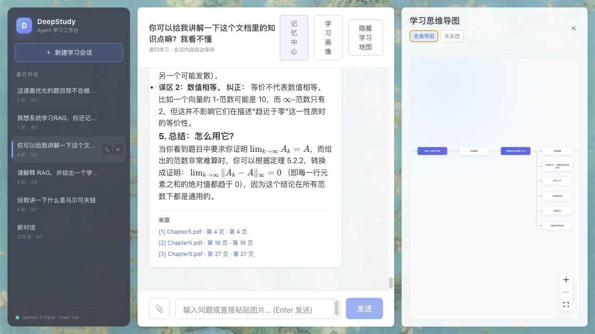
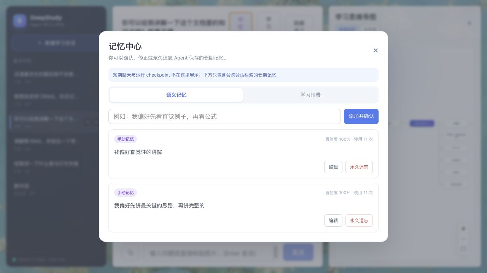
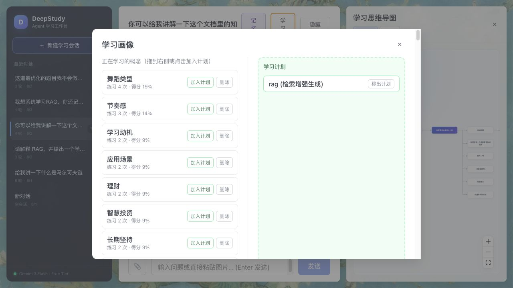
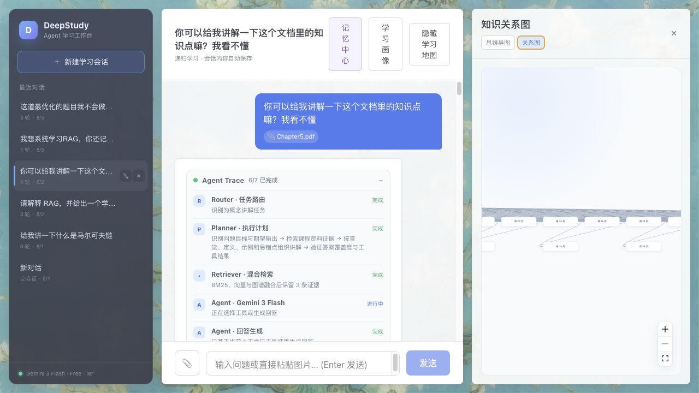

# DeepStudy 作品集说明

项目名称：**DeepStudy — 基于 LangGraph、GraphRAG 与分层记忆的自适应学习 Agent**

一句话定位：用户上传课程资料后，Agent 会规划任务、检索可追溯证据、按需调用工具、验证回答，并把值得保留的学习事件写入可控长期记忆。

## 90 秒演示


GIF 由真实本地界面截图生成，共 21 帧、1280×720、总时长 90,000 ms。运行
`make portfolio` 可以从 `docs/assets` 中的截图重新生成。

| 时间 | 画面 | 讲解重点 |
| --- | --- | --- |
| 00:00–00:12 | 项目标题 | LangGraph、GraphRAG、分层记忆三条主线 |
| 00:12–00:31 | 课程资料问答 | PDF 附件、正文回答与页码级来源 |
| 00:31–00:47 | Agent Trace | Router、Planner、Retriever、Tool、Verifier、Memory Writer |
| 00:47–01:02 | GraphRAG | 学习思维导图与知识关系图双视图 |
| 01:02–01:18 | 记忆中心 | 跨会话记忆可确认、编辑、永久遗忘 |
| 01:18–01:30 | 学习画像 | U/R/A、练习次数和学习计划持续更新 |

## 三分钟面试演示脚本

### 00:00–00:25：问题与定位

操作：停留在首页和会话列表。

讲稿：

> DeepStudy 不是普通聊天机器人，而是一个自适应学习 Agent。普通问答系统最大的问题是回答不可追溯、工具过程不可见，而且下一次对话会忘记学生真正卡在哪里。这个项目把资料检索、Agent 编排和分层记忆接成一个完整学习闭环。

### 00:25–00:55：资料上传与可追溯回答

操作：打开带 `Chapter5.pdf` 的会话，展示回答末尾三个来源链接。

讲稿：

> PDF 会保留页码，Markdown 保留标题层级，代码优先按类和函数切片。检索不是单一路径，而是 BM25、向量和 Neo4j 图谱候选经过加权 RRF 与词项覆盖率重排。回答中的编号引用能直接打开原文页，Verifier 会检查引用编号是否真实存在。

### 00:55–01:30：Agent 主链路与工具调用

操作：滚到 Agent Trace，指出 Retriever 或 `search_course_materials` Tool。

讲稿：

> 我把原来的固定 Python 调用顺序重构成 LangGraph 状态图：Router 识别任务，Planner 给出可展示计划，Gemini 用原生 Function Calling 选择工具，Executor 执行后把结构化结果送回模型，Verifier 再检查覆盖度和引用。SSE 只暴露安全执行摘要，不泄露 Chain-of-Thought，并且 Trace 会随消息持久化。

### 01:30–02:00：GraphRAG 与学习地图

操作：在“思维导图”和“关系图”之间切换。

讲稿：

> 右侧默认是符合学习者心智模型的树状思维导图；关系图则展示 Document、Chunk、Concept 及其来源关系。Neo4j 不可用时，主链路仍会退化到关键词与向量检索，不会让一次数据库故障阻断学习。

### 02:00–02:30：分层 Memory

操作：打开“记忆中心”，再打开“学习画像”。

讲稿：

> Memory 分成会话短期记忆、SQLite Checkpoint、跨会话语义和情景记忆，以及 U/R/A 学习画像。只有通过验证并达到阈值的内容才会写入长期记忆；用户可以确认、修正或永久遗忘，避免把错误推断变成不可控画像。

### 02:30–02:50：评测与工程可信度

操作：展示 README 的评测表和 CI。

讲稿：

> 仓库内有 30 条固定检索查询。相对旧版向量单路，当前混合检索的 MRR 从 0.9444 提升到 0.9667，nDCG@5 从 0.9587 提升到 0.9754。后端单测、前端生产构建和 Docker Compose 配置都进入 CI；这些数字只作为代码回归基线，不夸大成真实业务效果。

### 02:50–03:00：收束

讲稿：

> 这个项目最能体现的不是一个聊天 UI，而是我如何把可观察 Agent、可追溯 RAG 和用户可控 Memory 做成一个能够降级、评测和复现的完整系统。

## 评测前后对比

运行命令：

```bash
python -m backend.evals.run_rag_eval --compare
```

| 指标 | 旧版：确定性向量单路 | 当前：加权混合检索 | 绝对变化 |
| --- | ---: | ---: | ---: |
| 查询数 | 30 | 30 | — |
| Recall@5 | 1.0000 | 1.0000 | +0.0000 |
| MRR | 0.9444 | 0.9667 | +0.0223 |
| nDCG@5 | 0.9587 | 0.9754 | +0.0167 |

对比使用相同 `course_fixture.md`、相同相关章节标注和确定性 n-gram embedding。它验证排序代码没有回退，但语料规模较小、问题偏课程关键词，不应解释为线上泛化结果。下一步需要加入跨文档干扰项、语义改写问题和人工引用正确率标注。

## 截图

### Agent Trace 与学习思维导图


### 页码级来源



### 长期记忆中心



### 学习画像与学习计划



### 知识关系图



## 简历项目描述

### 一行版

**DeepStudy｜LangGraph 自适应学习 Agent**：构建集可观察工具调用、混合 GraphRAG、分层长期记忆与 MCP 于一体的学习系统，30 条离线检索集达到 Recall@5 1.0000、MRR 0.9667、nDCG@5 0.9754。

### 三条版

- 将线性 Orchestrator 重构为 LangGraph Router–Planner–Executor–Verifier 状态图，接入 Gemini 原生 Function Calling，并通过 SSE 实时展示和持久化 Agent Trace；普通无工具问题只需 1 次模型请求，工具问题通常 2 次。
- 设计 PDF/Markdown/TXT/代码结构化摄取与 BM25、向量、Neo4j 加权融合检索，提供页码/章节级引用；相对确定性向量单路，30 条固定集 MRR 提升 0.0223、nDCG@5 提升 0.0167。
- 实现会话、SQLite Checkpoint、语义/情景记忆和 U/R/A 画像四层状态，支持跨会话相关检索、哈希去重、时间衰减以及用户确认、编辑和永久遗忘；同时封装 4 个 Agent Skills 和独立 MCP Server。

### English one-liner

Built **DeepStudy**, an adaptive learning agent powered by LangGraph, Gemini function calling, hybrid GraphRAG, and user-controllable layered memory; achieved 1.0000 Recall@5, 0.9667 MRR, and 0.9754 nDCG@5 on a reproducible 30-query offline regression set.

## 诚实边界

- 当前是 `anonymous` 单用户场景，JWT 仅预留；不能表述为已完成多用户认证。
- Verifier 会检查答案覆盖度、工具失败和引用编号，但还不是独立 LLM 事实核查器。
- Neo4j 和 BGE 均有降级路径，因此演示可继续运行；降级结果不等价于完整 GraphRAG 质量。
- 离线指标只用于回归，面试时必须同时说明 30 条固定 fixture 的规模限制。
