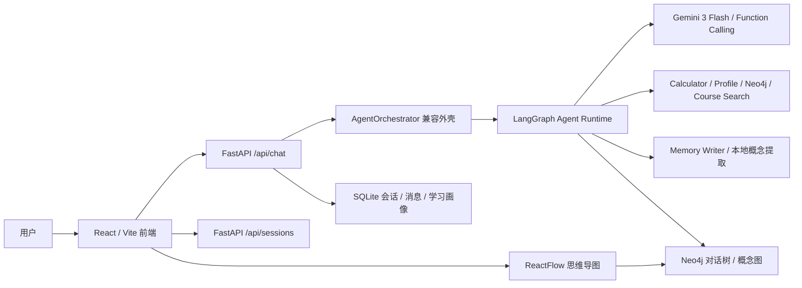

# DeepStudy 技术栈与改进复盘

这份文档用于说明 DeepStudy 原项目的技术基础、目前已经完成的改进，以及每项改进背后的原因。口径以简历、项目介绍和面试讲解为准：哪些已经落地，哪些还在路线图里，会明确区分。

## 1. 项目一句话定位

DeepStudy 原本是一个黑客松阶段的递归学习助手：用户提出问题，系统流式回答，并把对话和概念关系展示成图谱。

现在的优化方向是把它升级成更完整的学习型 Agent 项目：

> 一个支持多轮学习会话、知识图谱、学习画像、RAG 预留能力和 Agent 化编排演进的自适应学习系统。

当前项目已经使用 `React + FastAPI + LangGraph + Gemini + Neo4j + SQLite` 跑通核心学习闭环，并完成 Gemini Function Calling、标准 SSE 和 Agent Trace。MCP Server、Skills 运行时、完整 GraphRAG 与分层长期 Memory 仍属于后续阶段。

## 2. 原项目已有技术栈

### 2.1 前端

- React
- TypeScript
- Vite
- ReactFlow
- React Markdown
- KaTeX / remark-math / rehype-katex
- Axios

原前端优势是启动轻、开发快，适合黑客松 Demo。ReactFlow 已经能展示节点和边，因此天然适合做学习图谱、概念关系图或思维导图。

原前端主要问题是：

- 缺少类似 ChatGPT 的会话历史栏。
- 消息结构比较临时，不适合扩展附件、错误状态、重试和多会话。
- 图谱展示偏“关系图”，不够像学习者习惯看的思维导图。
- 交互状态不够细，例如模型额度耗尽、临时限流、后端错误没有清晰区分。

### 2.2 后端

- FastAPI
- Python
- Pydantic / pydantic-settings
- Uvicorn
- Neo4j Python Driver
- SQLite / aiosqlite
- python-multipart
- httpx
- python-dotenv

这里要特别讲清楚：FastAPI 不是后来替换 LangGraph 的结果。原项目本身就是 FastAPI 后端。FastAPI 的角色是 Web API 层，负责接收前端请求、返回流式响应、管理路由和连接数据库。

LangGraph 已经接入 FastAPI 内部作为 Agent Runtime，而不是替代 FastAPI。更准确的关系是：

```text
React 前端 -> FastAPI API 层 -> LangGraph / Agent 编排层 -> LLM / Tools / Memory / RAG
```

当前 `AgentOrchestrator` 是兼容外壳，内部实际委托给 `DeepStudyAgentGraph`。

### 2.3 模型与 AI 相关依赖

原项目曾经使用 Qwen / ModelScope 方向的配置，也有 LlamaIndex 相关依赖：

- llama-index-core
- llama-index-embeddings-huggingface
- torch
- transformers

这些依赖说明原项目已经有向量检索、知识提取或 RAG 的技术倾向，但聊天主链路并没有真正形成完整 GraphRAG。

### 2.4 数据层

- Neo4j：保存对话树、概念节点和图谱展示数据。
- SQLite：保存学习画像、学习计划、会话和消息。
- 本地向量存储路径：已有配置预留，但目前还不是聊天主流程的核心部分。

原项目比较有价值的一点是：它不是单纯聊天机器人，已经有“对话 -> 概念 -> 画像/图谱”的结构化沉淀思路。

## 3. 当前已经完成的改进

### 3.1 从 Qwen 切换到 Gemini 3 Flash 免费层

改动内容：

- 新增 Gemini Developer API 配置。
- 默认模型改为 `gemini-3-flash-preview`。
- 使用 Google Gen AI SDK 封装异步调用。
- 支持流式输出。
- 通过环境变量保留后续换模型能力。

为什么改：

- 用户明确不想使用付费模型。
- 原来的 Qwen 表现不够聪明，不适合作为作品集项目的核心体验。
- Gemini 3 Flash 免费层在可用性、推理能力和接入便利性之间比较平衡。

面试时可以这样说：

> 我把模型调用封装成独立客户端，通过环境变量切换模型，当前默认接入 Gemini 3 Flash 免费层。这样项目不会和某一个模型强绑定，也方便后续扩展到 OpenAI、Claude 或本地模型。

### 3.2 修复 LlamaIndex 依赖版本问题

改动内容：

- 调整 LlamaIndex 相关依赖版本。
- 修复 `ChatMessage` 导入失败导致后端无法启动的问题。

为什么改：

- 原依赖组合出现版本不兼容，导致项目基础功能无法稳定运行。
- 阶段 0 的目标是先让原有功能重新跑起来，再做架构升级。

### 3.3 增加 Gemini 请求节流与额度错误处理

改动内容：

- 给 Gemini 调用增加全局请求启动间隔。
- 识别临时限流和每日免费额度耗尽。
- 后端不再把 Google 原始长错误直接暴露给前端。
- 前端显示更友好的错误状态。

为什么改：

- Gemini 免费层有明确请求额度。截图里的错误不是普通“太快了”，而是每日免费额度 `20` 次已经用完。
- 原来一次用户提问可能触发多次模型调用：生成回答、概念提取、活动分类都会消耗额度。
- 免费模型项目最重要的是省调用、抗限流、错误可解释。

现在的策略：

- 每轮用户提问尽量只保留一次 LLM 主调用。
- 概念提取和学习活动分类改成本地规则，避免额外消耗 Gemini 免费额度。
- 遇到每日额度耗尽时，明确提示等待 Google 配额重置。

### 3.4 把概念提取改成本地启发式逻辑

改动内容：

- 新增本地 `concept_extractor`。
- 从用户问题、Markdown 标题、加粗术语中提取 root 和 children。
- 替代原先依赖 LLM 的概念结构提取。

为什么改：

- 节省 Gemini 免费额度。
- 降低响应失败概率。
- 保证图谱和学习画像在模型额度紧张时仍能更新。

代价：

- 本地启发式不如 LLM 语义理解强。
- 如果回答格式不规范，可能漏掉部分概念。

后续优化方向：

- LangGraph Memory Writer 已输出结构化学习事件并写入图谱和画像；后续再扩展来源证据与置信度。

### 3.5 把学习活动分类改成本地规则

改动内容：

- 原先活动分类可能调用 LLM。
- 现在根据中英文关键词判断 `explain`、`recall`、`derive`、`practice` 等学习活动类型。

为什么改：

- 这是一个低价值 LLM 调用，不值得消耗免费额度。
- 对学习画像而言，稳定的粗粒度分类比高成本语义分类更划算。

### 3.6 新增持久化会话历史

改动内容：

- 新增 SQLite 表：
  - `chat_sessions`
  - `chat_messages`
  - `message_attachments`
- 新增会话存储层。
- 新增 `/api/sessions` 系列接口。
- 前端新增左侧会话栏，支持新建、切换、重命名和删除会话。

为什么改：

- 原项目更像单次 Demo，对话刷新后上下文体验弱。
- 找实习展示时，类似 ChatGPT 的历史会话是用户最容易理解的产品能力。
- 会话是后续 Memory、文件上传、RAG 证据、Agent Trace 的基础数据模型。

### 3.7 重构前端聊天消息结构

改动内容：

- 前端从多个平行数组逐步转为统一的 `ChatTurn` 结构。
- 消息和错误状态更容易管理。
- 支持按 session 加载历史消息。

为什么改：

- 平行数组在 Demo 阶段能跑，但后续加附件、重试、引用、工具调用记录会非常脆。
- 统一消息结构更接近真实聊天产品的数据模型。

### 3.8 优化思维导图展示

改动内容：

- 保留 ReactFlow。
- 使用 dagre 做更稳定的左右布局。
- 移除一些不必要的伪操作按钮。
- 优化节点样式，让图谱更接近学习思维导图。

为什么改：

- 原图谱偏数据库关系图，学习者不容易直接理解。
- 当前阶段先让它“更像学习地图”，后续再拆成两种视图：
  - 学习思维导图：面向用户理解。
  - 知识图谱 / GraphRAG 视图：面向技术展示。

### 3.9 增加测试基线

改动内容：

- 增加或补齐后端测试：
  - Gemini 客户端错误解析
  - 本地概念提取
  - 会话存储
  - 活动分类
  - 配置加载
  - 知识提取
- 前端通过 lint 和 build。

为什么改：

- 作品集项目不能只靠“能跑一次”。
- 模型错误、会话存储和前后端状态是最容易坏的地方，应该有基础测试兜底。

## 4. 当前真实架构

当前已经落地的运行链路如下：



这个架构的优点是：

- 能稳定展示一个完整学习产品闭环。
- 免费模型额度下更省调用。
- 会话、画像、图谱已经有数据沉淀。
- FastAPI 已承载 LangGraph Runtime，并保留后续接 GraphRAG、Skills、MCP 的空间。

这个架构当前已经补齐：

- LangGraph 显式状态机与 `AgentState`。
- Gemini 原生 Function Calling 工具循环。
- Router、Planner、Tool Executor、Verifier、Memory Writer 节点。
- 标准 SSE 与可持久化 Agent Trace。

仍然存在的不足是：

- RAG 上传和聊天主链路还没有深度打通。
- Neo4j 当前主要是对话树和概念图，不是来源可追溯的领域知识图谱。
- Memory 目前主要是会话历史和学习画像，还不是完整的短期、语义、情景分层记忆。

## 5. 原 AgentOrchestrator 设计与 LangGraph 对比

### 5.1 原 AgentOrchestrator 的具体设计

原来的 `AgentOrchestrator` 是一个自定义的线性编排器，核心思路是：

```text
用户问题
-> IntentRouter 判断意图
-> 按意图选择 Strategy
-> Strategy 拼 Prompt 并调用 LLM
-> 流式返回给前端
-> 后处理：概念提取、学习画像更新、Neo4j 写入
```

代码结构上主要分成几层：

- `AgentOrchestrator`：总控流程，负责初始化模型、路由器、策略，并管理流式响应和后处理。
- `IntentRouter`：理论上负责把问题分成 `concept`、`derivation`、`code`。
- `ConceptStrategy` / `DerivationStrategy` / `CodeStrategy`：不同任务类型对应不同 Prompt。
- 后处理逻辑：回答结束后提取概念、更新 U/R/A 学习画像、写入 Neo4j 对话树和思维导图节点。

这个设计本质上是“策略模式 + 固定流水线”。它的优点是简单、直接、容易在黑客松阶段快速跑通，也很适合早期 Demo：

- 代码路径短，容易理解。
- 能支持流式回答。
- 策略类为概念解释、公式推导、代码回答预留了扩展点。
- 后处理能把对话沉淀到 Neo4j 和学习画像里。

### 5.2 原设计的主要缺点

第一个问题是“路由结构存在，但没有真正工作”。原实现的 `IntentRouter.route()` 固定返回 `CONCEPT`，所以所有问题都会走概念解释策略。虽然代码里有 `CodeStrategy` 和 `DerivationStrategy`，但当时的正常聊天主链路不会真正分流到它们。

第二个问题是“流程是硬编码流水线”。每轮请求的执行顺序由 Python 代码固定写死：取父上下文、选策略、调模型、流式返回、后处理。它不能根据中间结果动态决定下一步，比如“先检索资料，再查图谱，再计算公式，最后验证答案”。

第三个问题是“没有显式 Agent State”。原上下文主要靠局部变量和 `context` 字典传递，比如 `parent_context`、`parent_id`、`answer_parts`。这对简单对话没问题，但当系统加入 RAG 证据、工具调用、计划、验证结果、记忆更新时，状态会越来越散，不利于调试和展示。

第四个问题是“没有工具调用循环”。原 Strategy 基本是拼 Prompt 后直接让 LLM 生成答案。模型不能以结构化方式调用 `search_course_materials`、`query_concept_graph`、`calculate_expression` 等工具，也没有标准的 Act / Observe 过程。

第五个问题是“可观测性不足”。前端只能看到回答文本和最终图谱，看不到 Agent 做了什么决策：为什么选择这个任务类型、查了哪些资料、用了哪些工具、验证是否通过、写入了哪些记忆。作为作品集项目，这会让 Agent 能力不够显性。

第六个问题是“错误恢复和分支控制弱”。现在某个环节失败主要靠 `try/except` 降级，例如 Neo4j 写入失败就记录日志。对于复杂任务，它缺少统一的重试、回退、人工确认、证据不足时追问用户等流程控制。

第七个问题是“后处理和主推理分离”。概念提取、画像更新、图谱写入发生在回答生成之后，而且很多逻辑不进入模型决策过程。这样能省额度，但从 Agent 角度看，Memory Writer、Graph Writer、Verifier 都还不是一等节点。

### 5.3 采用 LangGraph 后的实际设计

LangGraph 不是为了让代码看起来更“新”，而是为了把 Agent 从固定流水线升级成显式状态机。当前实际结构是：

```text
AgentState
-> Router
-> Planner
-> Gemini Agent
-> Tool Executor（按需）
-> Gemini Agent（基于工具结果生成回答）
-> Verifier
-> Memory Writer / Graph Writer
```

对应到能力上：

- `AgentState` 统一保存消息、用户画像、任务计划、检索证据、工具调用、验证结果和记忆更新。
- `Router` 使用确定性规则真正判断任务类型，不额外消耗免费额度。
- `Planner` 生成结构化计划摘要与建议工具。
- `Tool Executor` 当前可调用课程检索、Neo4j 图谱、计算器和学习画像工具。
- `Verifier` 当前检查答案完整性和工具执行状态；引用一致性将在阶段 2 补齐。
- Gemini Agent 根据用户水平与工具结果组织最终回答。
- `Memory Writer` 和 `Graph Writer` 把值得保留的学习事件写入长期状态。

这样升级后，项目可以展示更明确的 Agent 工程能力：

- 有状态：不是一次 Prompt 调用，而是一个可追踪的任务状态机。
- 有工具：模型可以选择并调用外部工具。
- 有证据：RAG 和 GraphRAG 的结果能进入回答链路。
- 有验证：答案不是生成完就结束，而是经过检查。
- 有记忆：用户学习行为能进入后续决策。
- 有 Trace：前端可以展示计划、工具调用、证据和记忆更新，让面试官直接看到 Agent 在工作。

### 5.4 面试时可以怎么讲

推荐说法：

> 原项目的 AgentOrchestrator 是我早期为了黑客松快速实现的线性编排。现在我已经用 LangGraph 把它重构成显式状态机，将 Router、Planner、Gemini Agent、Tool Executor、Verifier、Memory Writer 拆成节点，并通过 Gemini Function Calling 调用外部工具。前端用 SSE 实时展示安全的 Agent Trace，Trace 也会随会话持久化。这样工具调用、知识图谱和学习记忆都成为可观察、可测试的 Agent 主链路。

## 6. 为什么没有把 FastAPI 换掉

FastAPI 和 LangGraph 不是二选一。

FastAPI 负责：

- 前端 HTTP 接口。
- 流式返回。
- 文件上传。
- 会话管理。
- 鉴权。
- 数据库读写。

LangGraph 负责：

- Agent 状态机。
- Router / Planner / Executor / Verifier / Memory Writer。
- 工具调用流程。
- Agent Trace。
- 复杂任务的可控推理路径。

所以正确演进方式是：

```text
保留 FastAPI
由 AgentOrchestrator 兼容外壳调用 LangGraph Runtime
```

这样既不推翻原项目，也能把项目从 Demo 升级成真正可讲的 Agent 工程。

## 7. 对找实习最有价值的讲法

可以强调的已经落地点：

- 我将黑客松 Demo 整理成了前后端分离的学习 Agent 应用。
- 后端基于 FastAPI，前端基于 React 和 TypeScript。
- 使用 Gemini 3 Flash 免费层作为默认 LLM，并封装了模型客户端，支持后续模型切换。
- 针对免费模型额度限制，我把低价值 LLM 调用改成本地规则，显著减少单轮请求消耗。
- 使用 SQLite 管理持久化会话、消息和学习画像。
- 使用 Neo4j 保存对话树和概念关系，并在前端以思维导图方式展示。
- 增加了会话历史、错误处理、限流提示和测试基线，让项目从 Demo 更接近真实产品。
- 使用 LangGraph 实现 Planner–Executor–Verifier 主链路和显式 AgentState。
- 使用 Gemini 原生 Function Calling 调用计算器、学习画像、Neo4j 和课程检索工具。
- 使用 SSE 展示并持久化 Router、Planner、Tool、Verifier、Memory Writer 执行轨迹。

需要谨慎表述的部分：

- 不能说“已经完成 GraphRAG”，目前只是有 Neo4j 图谱和 RAG 依赖/接口基础。
- 不能说“已经支持完整 MCP”，目前是路线图目标。
- 不能说“已经有完整 Memory 系统”，目前是会话历史 + 学习画像，分层记忆还在后续阶段。

推荐面试表述：

> 这个项目原本是一个黑客松学习助手。我保留 React + FastAPI 产品框架，接入 Gemini 3 Flash 免费模型，并把固定编排重构为 LangGraph Planner–Executor–Verifier 状态机。模型通过原生 Function Calling 使用学习画像、Neo4j、计算器和课程检索工具，前端实时展示并保存 Agent Trace。下一步重点是把文件上传、混合检索和来源引用接入主链路，完成 GraphRAG 与分层长期记忆。

## 8. 后续阶段建议

### 阶段 1：Agent 主链路（已完成）

- LangGraph `AgentState` 与状态图。
- Router、Planner、Gemini Agent、Tool Executor、Verifier、Memory Writer。
- Gemini Function Calling、标准 SSE、可持久化 Agent Trace。

### 阶段 2：RAG 与文件上传

- 前端支持 PDF / Markdown / TXT 上传。
- 后端做文档解析、切片、向量化。
- 聊天主链路调用 `search_course_materials`。
- 回答中展示引用来源。

### 阶段 3：知识图谱与 GraphRAG

- 从课程资料抽取 `Concept`、`Formula`、`Example`、`Question`。
- 保存 `chunk_id`、页码、章节和置信度。
- 实现图谱检索工具 `query_concept_graph`。
- 把“学习思维导图”和“技术知识图谱”拆成两个视图。

### 阶段 4：Memory、Skills、MCP

- Memory 分为短期记忆、语义记忆、情景记忆和学习画像。
- 增加 `skills/` 目录，例如 explain-concept、derive-formula、generate-practice。
- 实现 `deepstudy-mcp`，对外暴露课程检索、概念图查询和生成练习等工具。

## 9. 文件索引

核心配置：

- `backend/config.py`
- `.env.example`
- `backend/requirements.txt`
- `frontend/package.json`

模型调用：

- `backend/agent/llm_client.py`

当前 Agent 编排：

- `backend/agent/orchestrator.py`
- `backend/agent/intent_router.py`
- `backend/agent/strategies/`

本地概念与学习活动：

- `backend/agent/concept_extractor.py`
- `backend/agent/activity_classifier.py`

会话系统：

- `backend/data/sqlite_db.py`
- `backend/data/conversation_store.py`
- `backend/api/routes/sessions.py`
- `backend/api/routes/chat.py`

图谱与画像：

- `backend/data/neo4j_client.py`
- `backend/data/profile_store.py`
- `backend/api/routes/mindmap.py`
- `backend/api/routes/profile.py`

前端主要界面：

- `frontend/src/components/Chat/ChatInterface.tsx`
- `frontend/src/components/Chat/ConversationSidebar.tsx`
- `frontend/src/components/MindMap/KnowledgeGraph.tsx`
- `frontend/src/services/api.ts`
- `frontend/src/types/api.ts`

路线图与状态：

- `docs/OPTIMIZATION_ROADMAP.md`
- `backend/IMPLEMENTATION_STATUS.md`
